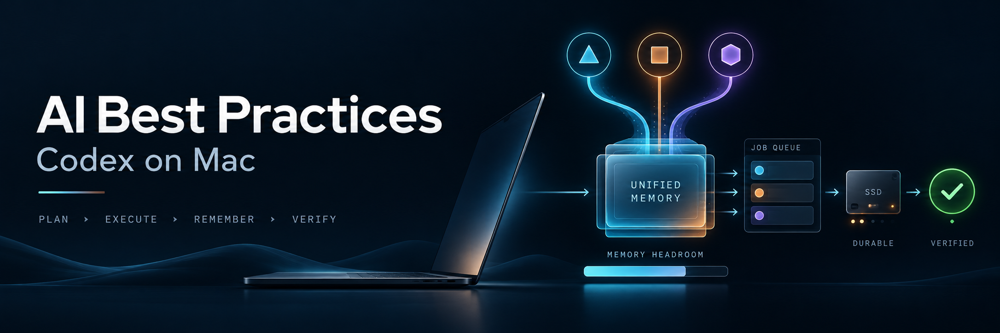
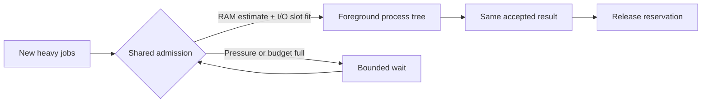

# AI Best Practices

**Practical Codex workflows for Macs with many concurrent AI jobs.**

[](https://github.com/Supersynergy/AI-Best-Practices/actions/workflows/check.yml)
[](LICENSE)


Finish useful work with less unnecessary search, smaller outputs and controlled resource use. This repository pairs concise guidance with a working RAM/I/O admission runner and a reproducible benchmark.

> **Measured scope:** the runner limits admission of cooperating foreground jobs. RAM reservations are declared peak estimates; I/O slots limit concurrency. These are not kernel memory limits or a bytes-per-second throttle. SSD lifetime improvement has not been measured.

## Start with one accepted result

Describe the outcome, relevant files, constraints and executable acceptance. Reproduce a behavior bug before changing it. Inspect the affected callers, make the smallest complete change and verify the integrated result. Preserve other people's work.

For parallel work, give each lane an owner, exclusive files and an oracle. Separate Git worktrees help keep changes independent. Include startup, integration, review and human rework when judging whether delegation helped. [OpenAI: prompting](https://developers.openai.com/codex/prompting/) · [worktrees](https://developers.openai.com/codex/app/worktrees/)

## A small tool policy

| Question | First useful tool |
|---|---|
| Find a path, symbol or text | Scoped `rg` / `rg --files` |
| Inspect Beads tasks | `bd ready`, `bd list`, `bd show` in the owning repository |
| Select or count JSON fields | `jq` and native command filters |
| Join, deduplicate or aggregate structured data | An existing helper or a bounded Python pass |
| Verify code | The repository's smallest relevant check, then required integrated checks |

Read an unchanged input once per question. Combine independent patterns and reads. Repeat when inputs changed, a result failed or acceptance requires another check. Keep raw output in bounded artifacts and return the decisive projection. A failed Beads query does not turn an old export into current state.

Use [AGENTS.md](AGENTS.md) as an adaptable template. OpenAI documents global/project instruction precedence and how to verify loading; loading guidance is a separate proof from following it consistently. [OpenAI: instruction discovery](https://developers.openai.com/codex/guides/agents-md/)

## Share one RAM/I/O budget



The runner uses one per-user registry and an advisory lock. It checks memory pressure and estimated available memory before admission, rejects oversized requests, waits with a deadline and preserves the child's exit code. Reservations survive an owner crash while the recorded process group remains alive. Nested invocations reuse a verified ancestor reservation and reject requests exceeding it.

Existing jobs are not adopted or interrupted. Keep commands in the foreground: independently detached sessions or external jobs do not become managed merely because they share the Mac. Reserve the peak of the entire child tree, including build workers and local model/GPU allocations.

### Install the runner

Requires Python 3.12+ and macOS. The core tests also run on Linux; Mac resource probes have been exercised on an M4 Max.

```sh
mkdir -p "$HOME/.local/bin"
install -m 755 scripts/mac_budget.py "$HOME/.local/bin/mac-resource-run"

mac-resource-run status
mac-resource-run run --memory-gib 4 --io-slots 1 --wait-seconds 60 -- your-build-command
```

Ensure `~/.local/bin` is in your `PATH`. Configure one shared profile at `~/.config/mac-workflow/resource-budget.json`:

```json
{
  "memory_budget_gib": 64,
  "io_slots": 1,
  "headroom_gib": 24,
  "disk_headroom_gib": 20,
  "live_guard": true
}
```

This is a conservative example for a 128-GiB Mac, not a profile for every machine. Without a file, the reservation cap defaults to half of physical RAM. All cooperating jobs must share the same state directory and configuration. See [profiles and integration](docs/mac-budget.md) for smaller Macs, existing wrappers and recovery.

### Measure the tradeoff

```sh
python3 -m unittest discover -s tests -v
python3 scripts/benchmark_budget.py --samples 3 --output docs/benchmark.json
```

The bounded benchmark runs three owned jobs with identical durable payloads. The I/O budget changes maximum active workers from **3 to 1**. It measures the footprint of workers plus waiting wrappers and the total wall time. Serial admission lowers simultaneous demand and can increase completion time; total payload bytes remain unchanged. [Recorded results and limits](docs/benchmark.md)

## Write less without losing recovery

Reuse valid build/model/download caches. Avoid repeated clean builds, redundant copies and full-file rewrites for tiny changes. Buffer disposable intermediate data and batch noncritical updates within an explicit recovery-loss budget. Preserve transactions, required synchronization, backups and audit evidence. [Apple: reducing disk writes](https://developer.apple.com/documentation/xcode/reducing-disk-writes)

macOS already uses spare memory for file caches. `/tmp` and ordinary cache folders are not automatically RAM-backed. An optional RAM disk needs a total budget across jobs and reconstructible contents; it can push other processes into paging. Check pressure and swapout rate rather than treating occupied RAM or a swap-used total as a current write rate. [Apple: memory usage](https://support.apple.com/guide/activity-monitor/view-memory-usage-actmntr1004/mac)

APFS volumes share space and may have reserves or quotas. Compare container accounting, per-volume use and `statvfs` availability before calling a disk full. Host write bytes, logical file bytes and NAND wear are different measurements. [Storage interpretation](docs/storage.md)

## Evidence and provenance

- [Primary-source ledger](docs/sources.md): OpenAI, Apple and official upstream references.
- [Benchmark data](docs/benchmark.json): executed synthetic workload, with timing and memory boundaries.
- [Tests](tests/test_budget.py): admission, deadlines, recovery, nested calls, process groups and failure paths.
- [Research limits](docs/research.md): Superweb/GH Max results, verification and unavailable agent execution.

This is an experimental public candidate. Independent model review is pending; local tests, static inspection and a successful probe do not establish production acceptance on every Mac.

## Contributing

Bring a reproducible workload, unchanged acceptance and measurements including failures, checking and recovery. Keep dependencies small, preserve ownership and include the latency/resource tradeoff. Do not submit secrets, private transcripts or machine identifiers. [Contribution guide](CONTRIBUTING.md)

## License

[MIT](LICENSE). The title artwork was generated for this project. This is an independent community project and is not an official OpenAI or Apple product.
