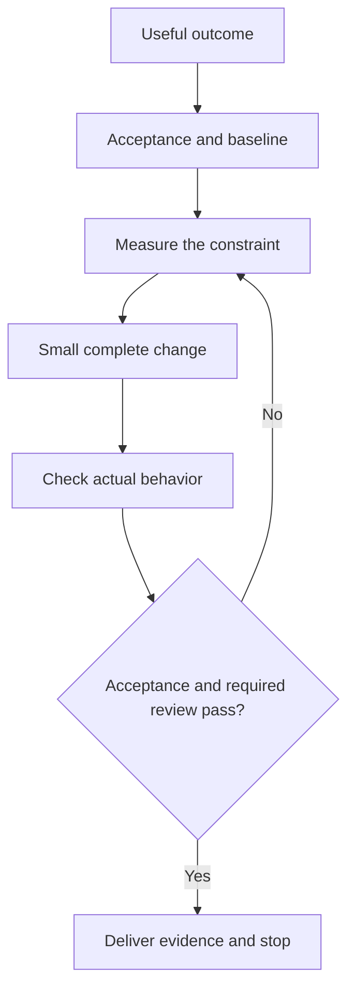

# AI Best Practices

**A practical guide to reliable AI-assisted development, with Codex examples.**

[](https://github.com/Supersynergy/AI-Best-Practices/actions/workflows/check.yml)
[](LICENSE)

Make useful changes with clear acceptance, short feedback loops and less repeated work. The guidance applies across machines, editors and teams. An optional macOS resource runner is included for workloads that need it.

**[20 principles](docs/principles.md) · [Bottleneck guide](docs/bottlenecks.md) · [Daily workflows](docs/workflows.md) · [Measurement](docs/measurement.md) · [Sources](docs/sources.md)**

## Start with the result

Give the agent a small task contract. Include the behavior that should change, the constraints it must preserve and the check that will decide whether it worked.

```text
Outcome: An empty search returns a useful next action.
Scope: Search component, its caller and the existing search tests.
Preserve: Keyboard focus, permissions and saved filters.
Acceptance: The empty-result test passes; the actual route works after reload.
Budget: One owner; reuse the current dependencies and relevant checks.
Return: What changed, executed evidence and remaining gaps.
```

Adapt [AGENTS.md](AGENTS.md) to the repository. Keep permanent instructions short; store task-specific details with the task. Verify instruction loading separately from actual behavior. [OpenAI: instruction discovery](https://developers.openai.com/codex/guides/agents-md/)

## Follow one delivery loop



For a behavior bug, observe the failure before fixing it. For a feature, define the expected result and reuse the relevant baseline. Mechanical edits need proportionate checks. Small batches make feedback and integration easier; generating more code does not establish useful delivery. [DORA: small batches](https://dora.dev/capabilities/working-in-small-batches/)

## Find the constraint before adding tools

| What feels slow | First useful move |
|---|---|
| Rework and changing requirements | Write one observable result and the behavior to preserve. |
| Repeated exploration | Search exact paths and reuse the same evidence snapshot. |
| Builds and tests | Time the changed component's check and the required final gate. |
| Review and integration | Reduce change size and waiting work; assign one writer per boundary. |
| Parallel jobs competing | Measure the critical path and shared CPU, memory and I/O demand. |
| Users repeating steps | Measure task success, decisions, interruptions and recovery. |

These are diagnostic starting points, not a universal ranking. The [bottleneck guide](docs/bottlenecks.md) connects symptoms to measurements, remedies and common mistakes.

## Keep tools and context focused

| Need | Starting tool |
|---|---|
| Find text, a symbol or a path | Scoped `rg` / `rg --files` |
| Inspect task dependencies | The tracker’s native commands; `bd ready/list/show` where installed |
| Select JSON fields | `jq` or the command’s native filters |
| Join, deduplicate or aggregate data | An existing helper or a bounded Python pass |
| Verify a change | The smallest relevant check, followed by required integrated checks |

Read unchanged input once per question. Batch independent reads, keep dependent changes in order and project noisy output before it enters context. Reopen discovery when evidence changes or a specific gap remains. Use current primary sources for external claims.

## Twenty principles, arranged by purpose

| Purpose | Principles |
|---|---|
| Choose useful work | 01 Accepted result · 02 Real needs · 03 Less imposed effort · 04 Ready work |
| Make the change | 05 Exact evidence · 06 Focused context · 07 Reuse and batching · 08 Small complete diff |
| Get reliable feedback | 09 Reproduce failures · 10 Short check loops · 11 Actual user flows · 12 Accessible states |
| Control time and resources | 13 Dominant cost · 14 Valid caches · 15 Total effort · 16 Shared budgets |
| Keep delivery dependable | 17 Independent ownership · 18 Resumable state · 19 Safe boundaries · 20 Honest completion |

Each [principle](docs/principles.md) has a practical action and a way to check it. The [workflow examples](docs/workflows.md) cover a bug, a feature, a performance change and parallel delivery.

## Measure the whole result

Track elapsed time to acceptance, human effort, retries, review and recovery. Keep quality and safety gates fixed. Record cold and warm behavior separately. Tokens, commits and tool counts can help diagnosis, but cannot stand in for productivity. [Microsoft Research: SPACE](https://www.microsoft.com/en-us/research/publication/the-space-of-developer-productivity-theres-more-to-it-than-you-think/)

Use the [measurement template](docs/measurement.md) for a reproducible comparison. AI results depend on the workload and evaluation design; older studies do not establish the speed of current Codex workflows. [METR: 2026 measurement limitations](https://metr.org/blog/2026-02-24-uplift-update/)

## Optional macOS resource control

The included Python 3.12+ runner admits cooperating foreground jobs against declared peak RAM and I/O slots. It is experimental admission control, with no kernel memory cap or bandwidth throttle. Start with [installation and profiles](docs/mac-budget.md), then inspect [storage guidance](docs/storage.md) and [executed benchmark limits](docs/benchmark.md).

The recorded synthetic benchmark reduced simultaneous process footprint while increasing completion time. Logical payload writes were unchanged. SSD lifetime improvement and universal productivity gains remain unmeasured. Independent model review of the runner is pending.

## Contribute

Bring a reproducible problem, preserve the accepted behavior and report the tradeoff. Keep private transcripts, credentials and machine identifiers out of submissions. See [contribution guidance](CONTRIBUTING.md) and [research boundaries](docs/research.md).

[MIT license](LICENSE). Original title artwork generated for this project. Independent community guidance, with no affiliation to OpenAI or Apple.
